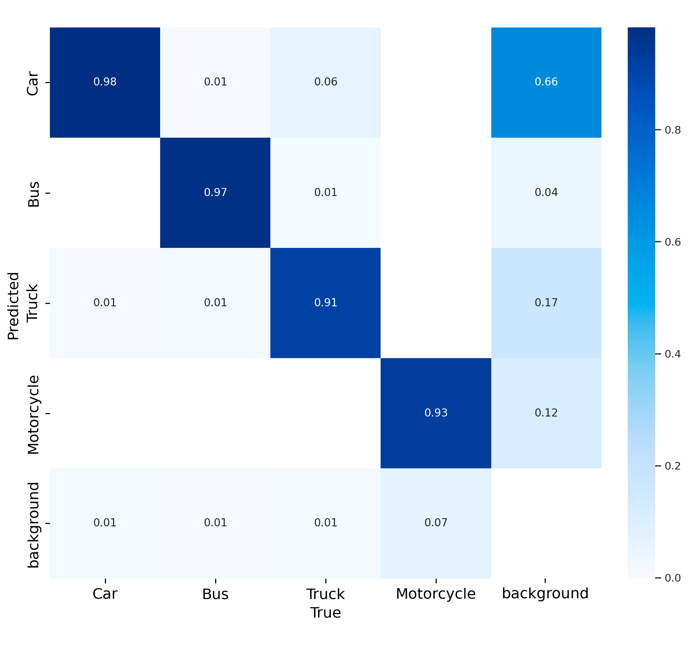
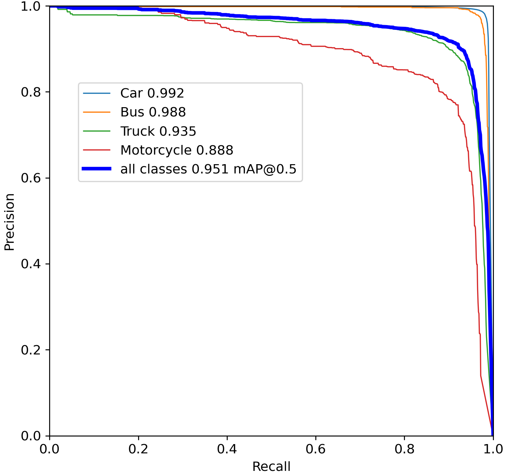

# Detection and tracking

[Extraction](extract.md) finds vehicles in every frame with a YOLO detector and links the detections into tracks with a multi-object tracker. This page covers choosing and tuning both.

## Detection model

The default model is geo-trax's YOLOv8s, trained on bird's-eye view footage taken from 140 to 150 m in 4K. It downloads from [Hugging Face](https://huggingface.co/rfonod/geo-trax) on first use and is cached by `huggingface_hub` (`~/.cache/huggingface/hub` by default; set `HF_HOME` or `HF_HUB_CACHE` to move it). Its test results are [below](#detection-performance), and its training data is described on the model card. At other altitudes or resolutions vehicles appear at other sizes; if small ones are missed, try [SAHI](sahi.md) or a model trained on your footage.

Any Ultralytics-compatible model can replace it, via `--model` or [`extraction.model`](../reference/config/extraction.md#extraction.model):

```bash
geotrax extract video.mp4 --model path/to/best.pt                     # a local file
geotrax extract video.mp4 --model hf://<org>/<repo>/<file>.pt         # Hugging Face, latest on 'main'
geotrax extract video.mp4 --model hf://<org>/<repo>@<revision>/<file>.pt  # pinned: commit SHA, tag or branch
```

Training and export scripts for custom detectors are in [`train/`](https://github.com/rfonod/geo-trax/blob/main/train/README.md) in the source repository.

### Detection performance

The table reproduces Table 3 of the [paper](https://doi.org/10.1016/j.trc.2025.105205): the default model on the [Songdo Vision v1](https://doi.org/10.5281/zenodo.13828408) test split (1,084 images, 55,124 vehicles). The bold values after the slash are the shipped model, whose training included the Songdo Vision train split. The values before the slash come from the same training without that split, which shows what the curated, high-quality annotations add.

| Class | Precision | Recall | mAP@50 | mAP@50-95 |
|---|---|---|---|---|
| All | 0.766 / **0.911** | 0.690 / **0.935** | 0.742 / **0.951** | 0.503 / **0.711** |
| Car (incl. vans) | 0.934 / **0.979** | 0.971 / **0.981** | 0.970 / **0.992** | 0.702 / **0.835** |
| Bus | 0.862 / **0.952** | 0.853 / **0.977** | 0.906 / **0.988** | 0.690 / **0.826** |
| Truck | 0.737 / **0.887** | 0.410 / **0.916** | 0.593 / **0.935** | 0.421 / **0.722** |
| Motorcycle | 0.532 / **0.827** | 0.527 / **0.866** | 0.499 / **0.888** | 0.197 / **0.463** |

Cars and buses are detected almost perfectly. Trucks and motorcycles gain the most from the Songdo Vision data; truck recall, for example, rises from 0.41 to 0.92. Motorcycles remain the hardest class: they are small and rare in the test set (805 of the 55,124 vehicles), and they account for most of the gap in mAP@50-95.

The plots below are Figure 4 of the paper, for the shipped model on the same test split. In the confusion matrix each column is a true class, so the bottom row is the share of each class that was missed, and the right-hand column splits the false positives (detections with no matching ground-truth box) by predicted class. The precision-recall curves give the mAP@50 of each class in the legend.

<div class="figure-pair" markdown>
<figure markdown="span">
  
  <figcaption>Normalized confusion matrix</figcaption>
</figure>
<figure markdown="span">
  
  <figcaption>Precision-recall curves</figcaption>
</figure>
</div>

!!! note "Songdo Vision v2"
    These results were measured on Songdo Vision v1. [Songdo Vision v2](https://doi.org/10.5281/zenodo.21728430) is an annotation-quality release whose test split holds 55,528 vehicles, so the numbers above should not be compared directly with results reported on v2. The model has not been retrained or re-evaluated on v2.

## Classes

The default model detects car (including vans, ID 0), bus (1), truck (2) and motorcycle (3). Its weights also hold pedestrian and bicycle classes, which are underrepresented, not evaluated, and left out by the default [`ultralytics.classes`](../reference/config/ultralytics.md#ultralytics.classes) filter `[0, 1, 2, 3]`.

- `--classes 0 1` keeps only the listed class IDs. With a custom model, set it to that model's IDs.
- `--class-names 0=vehicle 1=bus` (or [`extraction.class_rename`](../reference/config/extraction.md#extraction.class_rename), an inline mapping or a `.yaml`/`.json` file) renames classes in the videos, plots and run metadata. Names come from the CLI first, then the config, then the model; a class with no name is shown by its ID.

## Confidence thresholds

`--conf` ([`ultralytics.conf`](../reference/config/ultralytics.md#ultralytics.conf), 0.25 by default) is the global threshold. A single threshold rarely suits every class: rare or harder classes such as buses and trucks often deserve a lower bar than abundant cars. [`extraction.class_conf`](../reference/config/extraction.md#extraction.class_conf) sets a threshold per class ID, and classes it does not list keep the global one:

```bash
geotrax extract video.mp4 --set 'class_conf={1: 0.15, 2: 0.4}'
```

The detector runs at the lowest of these thresholds, and each detection is then held to the threshold of its own class *before* it reaches the tracker, so a rejected box never starts or extends a track. Each track later gets a single class by a confidence-weighted vote over its detections, so the output can still hold rows of a class below that class's threshold: detections of another class on the same track, kept under their own class's threshold. The thresholds also apply in SAHI mode. Lowering a threshold lets more boxes compete for [`ultralytics.max_det`](../reference/config/ultralytics.md#ultralytics.max_det), so raise that if a dense scene hits the cap.

## Trackers

Six multi-object trackers from [Ultralytics](https://github.com/ultralytics/ultralytics) are available; [`tracker.active`](../reference/config/tracker.md#tracker.active) selects one, and BoT-SORT is the default.

| Tracker | `tracker.active` | ReID | GMC¹ | Strengths | Weaknesses |
|---|---|:-:|:-:|---|---|
| **BoT-SORT** (default) | `botsort` | opt | ✅ | Strong accuracy; motion plus optional appearance | Slower; ReID adds compute |
| **ByteTrack** | `bytetrack` | ❌ | ❌ | Fastest; two-stage association | More ID switches under occlusion |
| **OC-SORT** | `ocsort` | ❌ | ❌ | Robust to non-linear motion; lightweight | Weaker on long occlusions |
| **Deep OC-SORT** | `deepocsort` | opt | opt | OC-SORT plus appearance; dense scenes | Heaviest variant with ReID |
| **FastTracker** | `fasttrack` | ❌ | ❌ | Occlusion-aware ByteTrack variant | Newer; several knobs to tune |
| **TrackTrack** | `tracktrack` | opt | ✅ | Multi-cue cost; best ID retention | Most parameters; highest compute |

¹ GMC (global motion compensation) corrects for camera motion inside the tracker, during association on the original frames. It is independent of the [stabilization](extract.md) of the trajectories that follows.

```bash
geotrax extract video.mp4 --set tracker.active=bytetrack               # another tracker
geotrax extract video.mp4 --set tracker.botsort.track_buffer=60        # one of its parameters
geotrax config show default                                            # every tracker's parameters, documented
```

Each tracker has its own parameter block in [`tracker`](../reference/config/tracker.md), and only the active one is used, so a parameter must be set in the block of the tracker you run. Things to know when tuning:

- **`track_buffer`** is how many frames a lost track survives. It also caps `--interpolate`: gaps longer than the active tracker's `track_buffer` are left unfilled.
- **ReID** (`with_reid: true`) adds an appearance model for re-identifying vehicles after occlusions, at a compute cost. With `model: auto` it uses features derived from the detector where they are available.
- **GMC** with `gmc_method: sparseOptFlow` (BoT-SORT and TrackTrack) needs OpenCV's `video` module. Stock OpenCV wheels have it; for a custom CUDA build of OpenCV, see [GPU acceleration](gpu.md#1-build-opencv-with-cuda).
- **SAHI** mode rejects `tracktrack` and ReID with `model: auto`, which both need a live Ultralytics predictor; see [SAHI](sahi.md#limitations).
- **Short tracks** are dropped after tracking by [`extraction.min_track_length`](../reference/config/extraction.md#extraction.min_track_length).

To compare trackers on your own footage, [`tools/compare_tracking.py`](https://github.com/rfonod/geo-trax/blob/main/tools/compare_tracking.py) in the source repository runs them side by side.
